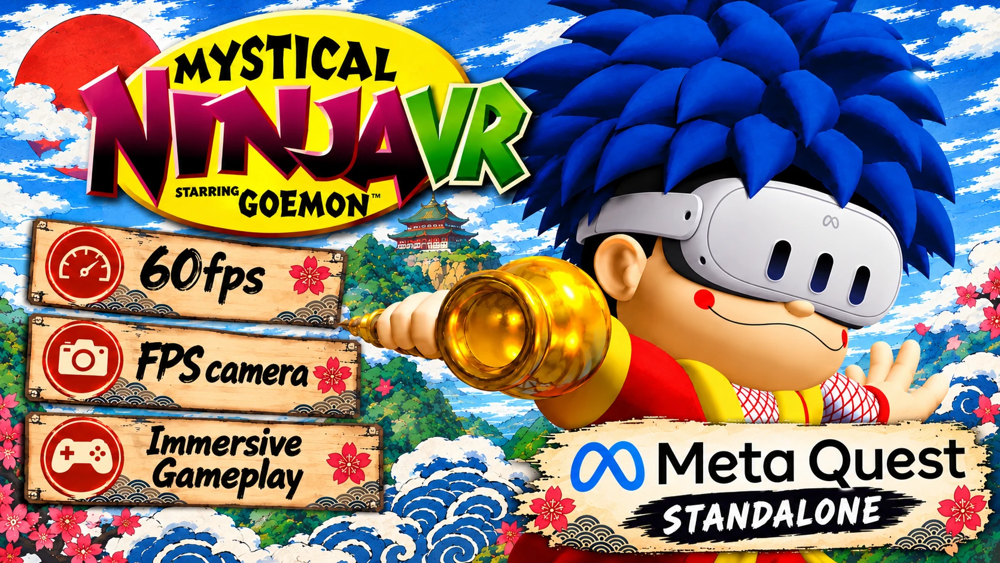

# Mystical Ninja VR starring Goemon: Meta Quest 3 Standalone

A standalone port of [Goemon 64: Recompiled](https://github.com/klorfmorf/Goemon64Recomp) (Mystical Ninja Starring Goemon) that runs natively on the Meta Quest 3. Explore Oedo in VR!

> **⚠️ You must own the game.** This project does not include Mystical Ninja Starring Goemon or any of its assets. Use a ROM made from your own cartridge (North American / USA version). Do not ask for ROMs.

## Features

- **60 FPS**, every level.
- **Immersive view:** you look around with your head; the camera follows Goemon smoothly.
- **First-person camera:** see the world through Goemon's eyes, with his body and attacks still visible.
- **Sharp picture:** 2688 x 2816 per frame with 2x anti-aliasing.
- **Plug and play:** pick your ROM in the start window and play.

## Install

1. Download the APK from [Releases](../../releases).
2. Install it with SideQuest (or `adb install`).
3. Start it from **Library > Unknown Sources**.
4. On first start, choose your copy of the game (North American / USA version) in the start window. The game checks the file and remembers it; after that just press **Play**.

## Controls

| Button | Action |
|---|---|
| Left stick | Move (walks where you look) |
| Left stick click | First person on / off |
| A / B | Jump / attack |
| X / Y | Change weapon / magic |
| Left grip | Minimap |
| Right grip | Change character |
| Left trigger | Camera control |
| Right trigger | Crawl |
| Right stick | Turn, camera distance |
| Right stick click | Camera behind Goemon |
| Menu button | Pause |

## Building from source

This repository is the full source of the Quest port (the `quest-vr` work on top of Goemon 64: Recompiled). The libraries it uses are git submodules at their upstream versions; the Quest changes to RT64, plume, zstd, nativefiledialog-extended, mupen64plus-win32-deps and N64ModernRuntime are in `quest/submodule-patches`.

```bash
git clone --recursive https://github.com/VistaLargaGames/Mystical-Ninja-VR.git
cd Mystical-Ninja-VR
bash quest/apply_submodule_patches.sh
```

Then follow [BUILDING.md](BUILDING.md) for the game code (you need your own ROM) and the Quest steps in [CLAUDE.md](CLAUDE.md) ("Building"): Android NDK 29, `tools/quest/configure_android.sh`, then `tools/quest/package.sh`. The VR code is in `src/quest/` (OpenXR session, head-aimed camera, picture pacing) and `patches/` (camera, sky and viewport hooks). `CLAUDE.md` is the full development log.

## Known issues

- The title, menus and pause are shown on a floating screen in front of you.

## Credits

Built on [Goemon 64: Recompiled](https://github.com/klorfmorf/Goemon64Recomp) by klorfmorf and contributors (GPL-3.0), [N64Recomp](https://github.com/N64Recomp/N64Recomp), [N64ModernRuntime](https://github.com/N64Recomp/N64ModernRuntime) and [RT64](https://github.com/rt64/rt64) (MIT). The original README is in [docs/README-Goemon64Recomp.md](docs/README-Goemon64Recomp.md).

Licensed under the GPL-3.0 (see [COPYING](COPYING)).

Not affiliated with Konami, Nintendo or Meta.

ENJOY!
